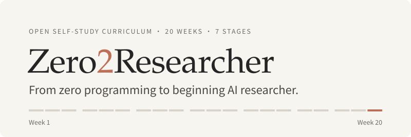
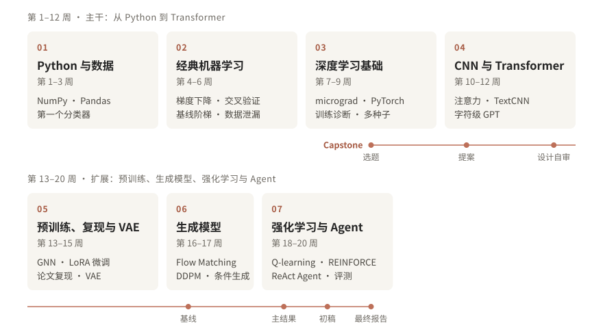

<picture>
  <source media="(prefers-color-scheme: dark)" srcset="assets/hero-dark.svg">
  
</picture>

<p align="center">
  一门开源的 20 周自学课程：从零编程基础出发，<br>
  到独立完成一项有基线、有对照、有消融、可复现的 AI 计算实验。
</p>

<p align="center">
  <a href="#开始学习">开始学习</a> &nbsp;·&nbsp;
  <a href="#课程地图">课程地图</a> &nbsp;·&nbsp;
  <a href="#怎么学">怎么学</a> &nbsp;·&nbsp;
  <a href="学习指南.md">学习指南</a>
</p>

<br>

Zero2Researcher 写给没有编程基础的实验生物学研究者。你不需要会编程，也不需要系统学过线性代数或概率论：你在实验台边练出的习惯——提出假设、设置对照、做重复、警惕污染——正是 AI 研究最需要的东西。

课程全程使用 AI 教学中的经典数据集（Iris、Titanic、MNIST、CIFAR-10、IMDB 影评、Tiny Shakespeare、Cora、CartPole……），内容本身不依赖生物学背景；生物学应用留给最后的 Capstone，你可以把学到的方法用在自己实验室的数据上。

- **形式**：60 本 Jupyter notebook，每周一本讲义、一本练习、一本作业；自查函数即时告诉你结果对不对。
- **时长**：20 周。讲义与练习约 160 小时，另加每周 4–8 小时的作业。
- **环境**：Google Colab，只需要浏览器；第 14 周的正式实验用 Colab 免费的 T4 GPU。
- **产出**：5 次研究实验、1 次论文复现，以及一个从选题走到 4 页报告的 Capstone 研究项目。

## 开始学习

1. 打开 **[第 1 周讲义](https://colab.research.google.com/github/ReaganGen/Zero2Researcher/blob/main/notebooks/week01/01_lecture.ipynb)**，运行第一格——它会安装课程工具包 `zero2researcher`。
2. 在 Colab 中选择「文件 → 在云端硬盘中保存一份副本」，之后都在自己的副本上学习。
3. 读一遍 [学习指南](学习指南.md)：每周的节奏、AI 编程助手约定、自评表和 Capstone 指南都在里面。

<details>
<summary>在本地运行</summary>
<br>

需要 Python 3.10 或更新版本（课程在 3.12 上测试）。

```bash
git clone https://github.com/ReaganGen/Zero2Researcher.git
cd Zero2Researcher
python -m pip install -e . jupyterlab torch torchvision
jupyter lab notebooks
```

第 7 周起要用 PyTorch 与 torchvision。第 13、14、18、19 周用到的 PyTorch Geometric、transformers、PEFT、Gymnasium 与 Anthropic SDK，会在各自 notebook 的第一格按需安装。运行时下载的数据集统一缓存在 `~/.cache/zero2researcher`，可用环境变量 `Z2R_DATA` 修改位置。

</details>

## 课程地图

<picture>
  <source media="(max-width: 600px) and (prefers-color-scheme: dark)" srcset="assets/course-map-compact-dark.svg">
  <source media="(max-width: 600px)" srcset="assets/course-map-compact-light.svg">
  <source media="(prefers-color-scheme: dark)" srcset="assets/course-map-dark.svg">
  
</picture>

| 周 | 主题 | 研究环节 | Notebook |
| :-- | :-- | :-- | :-- |
| 1 | Python I：变量、容器、循环 | — | [讲义](https://colab.research.google.com/github/ReaganGen/Zero2Researcher/blob/main/notebooks/week01/01_lecture.ipynb) · [练习](https://colab.research.google.com/github/ReaganGen/Zero2Researcher/blob/main/notebooks/week01/01_exercises.ipynb) · [作业](https://colab.research.google.com/github/ReaganGen/Zero2Researcher/blob/main/notebooks/week01/01_homework.ipynb) |
| 2 | Python II：函数、文件、NumPy、绘图 | — | [讲义](https://colab.research.google.com/github/ReaganGen/Zero2Researcher/blob/main/notebooks/week02/02_lecture.ipynb) · [练习](https://colab.research.google.com/github/ReaganGen/Zero2Researcher/blob/main/notebooks/week02/02_exercises.ipynb) · [作业](https://colab.research.google.com/github/ReaganGen/Zero2Researcher/blob/main/notebooks/week02/02_homework.ipynb) |
| 3 | Python III：Pandas、调试、类 | Python 阶段自测 | [讲义](https://colab.research.google.com/github/ReaganGen/Zero2Researcher/blob/main/notebooks/week03/03_lecture.ipynb) · [练习](https://colab.research.google.com/github/ReaganGen/Zero2Researcher/blob/main/notebooks/week03/03_exercises.ipynb) · [作业](https://colab.research.google.com/github/ReaganGen/Zero2Researcher/blob/main/notebooks/week03/03_homework.ipynb) · [自测](https://colab.research.google.com/github/ReaganGen/Zero2Researcher/blob/main/notebooks/week03/03_checkpoint.ipynb) |
| 4 | 线性回归与梯度下降 | 数学工作坊 1 | [讲义](https://colab.research.google.com/github/ReaganGen/Zero2Researcher/blob/main/notebooks/week04/04_lecture.ipynb) · [练习](https://colab.research.google.com/github/ReaganGen/Zero2Researcher/blob/main/notebooks/week04/04_exercises.ipynb) · [作业](https://colab.research.google.com/github/ReaganGen/Zero2Researcher/blob/main/notebooks/week04/04_homework.ipynb) |
| 5 | 分类、评估、交叉验证、树模型 | 数据泄漏专题 | [讲义](https://colab.research.google.com/github/ReaganGen/Zero2Researcher/blob/main/notebooks/week05/05_lecture.ipynb) · [练习](https://colab.research.google.com/github/ReaganGen/Zero2Researcher/blob/main/notebooks/week05/05_exercises.ipynb) · [作业](https://colab.research.google.com/github/ReaganGen/Zero2Researcher/blob/main/notebooks/week05/05_homework.ipynb) |
| 6 | 无监督学习与基线阶梯 | 第一条实验记录 · 数学工作坊 2 | [讲义](https://colab.research.google.com/github/ReaganGen/Zero2Researcher/blob/main/notebooks/week06/06_lecture.ipynb) · [练习](https://colab.research.google.com/github/ReaganGen/Zero2Researcher/blob/main/notebooks/week06/06_exercises.ipynb) · [作业](https://colab.research.google.com/github/ReaganGen/Zero2Researcher/blob/main/notebooks/week06/06_homework.ipynb) |
| 7 | 神经网络与 micrograd | 梯度检查 | [讲义](https://colab.research.google.com/github/ReaganGen/Zero2Researcher/blob/main/notebooks/week07/07_lecture.ipynb) · [练习](https://colab.research.google.com/github/ReaganGen/Zero2Researcher/blob/main/notebooks/week07/07_exercises.ipynb) · [作业](https://colab.research.google.com/github/ReaganGen/Zero2Researcher/blob/main/notebooks/week07/07_homework.ipynb) |
| 8 | PyTorch 与训练循环 | Capstone 选题 | [讲义](https://colab.research.google.com/github/ReaganGen/Zero2Researcher/blob/main/notebooks/week08/08_lecture.ipynb) · [练习](https://colab.research.google.com/github/ReaganGen/Zero2Researcher/blob/main/notebooks/week08/08_exercises.ipynb) · [作业](https://colab.research.google.com/github/ReaganGen/Zero2Researcher/blob/main/notebooks/week08/08_homework.ipynb) |
| 9 | 优化、正则化与调试 | 研究实验 1 | [讲义](https://colab.research.google.com/github/ReaganGen/Zero2Researcher/blob/main/notebooks/week09/09_lecture.ipynb) · [练习](https://colab.research.google.com/github/ReaganGen/Zero2Researcher/blob/main/notebooks/week09/09_exercises.ipynb) · [作业](https://colab.research.google.com/github/ReaganGen/Zero2Researcher/blob/main/notebooks/week09/09_homework.ipynb) |
| 10 | CNN 与归纳偏置 | 研究实验 2 · Capstone 提案 | [讲义](https://colab.research.google.com/github/ReaganGen/Zero2Researcher/blob/main/notebooks/week10/10_lecture.ipynb) · [练习](https://colab.research.google.com/github/ReaganGen/Zero2Researcher/blob/main/notebooks/week10/10_exercises.ipynb) · [作业](https://colab.research.google.com/github/ReaganGen/Zero2Researcher/blob/main/notebooks/week10/10_homework.ipynb) |
| 11 | Attention 与 Transformer | 位置编码检验 | [讲义](https://colab.research.google.com/github/ReaganGen/Zero2Researcher/blob/main/notebooks/week11/11_lecture.ipynb) · [练习](https://colab.research.google.com/github/ReaganGen/Zero2Researcher/blob/main/notebooks/week11/11_exercises.ipynb) · [作业](https://colab.research.google.com/github/ReaganGen/Zero2Researcher/blob/main/notebooks/week11/11_homework.ipynb) |
| 12 | 训练小型语言模型 | Capstone 设计自审 | [讲义](https://colab.research.google.com/github/ReaganGen/Zero2Researcher/blob/main/notebooks/week12/12_lecture.ipynb) · [练习](https://colab.research.google.com/github/ReaganGen/Zero2Researcher/blob/main/notebooks/week12/12_exercises.ipynb) · [作业](https://colab.research.google.com/github/ReaganGen/Zero2Researcher/blob/main/notebooks/week12/12_homework.ipynb) |
| 13 | GNN 与预训练概念 | 论文复现启动 | [讲义](https://colab.research.google.com/github/ReaganGen/Zero2Researcher/blob/main/notebooks/week13/13_lecture.ipynb) · [练习](https://colab.research.google.com/github/ReaganGen/Zero2Researcher/blob/main/notebooks/week13/13_exercises.ipynb) · [作业](https://colab.research.google.com/github/ReaganGen/Zero2Researcher/blob/main/notebooks/week13/13_homework.ipynb) |
| 14 | 预训练模型微调与 LoRA | 研究实验 3 · 数学工作坊 3 | [讲义](https://colab.research.google.com/github/ReaganGen/Zero2Researcher/blob/main/notebooks/week14/14_lecture.ipynb) · [练习](https://colab.research.google.com/github/ReaganGen/Zero2Researcher/blob/main/notebooks/week14/14_exercises.ipynb) · [作业](https://colab.research.google.com/github/ReaganGen/Zero2Researcher/blob/main/notebooks/week14/14_homework.ipynb) |
| 15 | 自编码器与 VAE | 复现报告 | [讲义](https://colab.research.google.com/github/ReaganGen/Zero2Researcher/blob/main/notebooks/week15/15_lecture.ipynb) · [练习](https://colab.research.google.com/github/ReaganGen/Zero2Researcher/blob/main/notebooks/week15/15_exercises.ipynb) · [作业](https://colab.research.google.com/github/ReaganGen/Zero2Researcher/blob/main/notebooks/week15/15_homework.ipynb) |
| 16 | Flow Matching | Capstone 基线 | [讲义](https://colab.research.google.com/github/ReaganGen/Zero2Researcher/blob/main/notebooks/week16/16_lecture.ipynb) · [练习](https://colab.research.google.com/github/ReaganGen/Zero2Researcher/blob/main/notebooks/week16/16_exercises.ipynb) · [作业](https://colab.research.google.com/github/ReaganGen/Zero2Researcher/blob/main/notebooks/week16/16_homework.ipynb) |
| 17 | DDPM 与条件生成 | 研究实验 4 | [讲义](https://colab.research.google.com/github/ReaganGen/Zero2Researcher/blob/main/notebooks/week17/17_lecture.ipynb) · [练习](https://colab.research.google.com/github/ReaganGen/Zero2Researcher/blob/main/notebooks/week17/17_exercises.ipynb) · [作业](https://colab.research.google.com/github/ReaganGen/Zero2Researcher/blob/main/notebooks/week17/17_homework.ipynb) |
| 18 | 强化学习 | 研究实验 5 · Capstone 主结果 | [讲义](https://colab.research.google.com/github/ReaganGen/Zero2Researcher/blob/main/notebooks/week18/18_lecture.ipynb) · [练习](https://colab.research.google.com/github/ReaganGen/Zero2Researcher/blob/main/notebooks/week18/18_exercises.ipynb) · [作业](https://colab.research.google.com/github/ReaganGen/Zero2Researcher/blob/main/notebooks/week18/18_homework.ipynb) |
| 19 | AI Agents | Capstone 初稿 | [讲义](https://colab.research.google.com/github/ReaganGen/Zero2Researcher/blob/main/notebooks/week19/19_lecture.ipynb) · [练习](https://colab.research.google.com/github/ReaganGen/Zero2Researcher/blob/main/notebooks/week19/19_exercises.ipynb) · [作业](https://colab.research.google.com/github/ReaganGen/Zero2Researcher/blob/main/notebooks/week19/19_homework.ipynb) |
| 20 | Capstone 报告与课程总结 | 最终报告 | [讲义](https://colab.research.google.com/github/ReaganGen/Zero2Researcher/blob/main/notebooks/week20/20_lecture.ipynb) · [作业](https://colab.research.google.com/github/ReaganGen/Zero2Researcher/blob/main/notebooks/week20/20_homework.ipynb) |

## 怎么学

**每周三本 notebook。** 讲义（`lecture`）分 S1–S4 四节，先讲原理，再把关键代码留给你跟着讲解写出来；练习（`exercises`）和作业（`homework`）把同样的方法用到新问题上。所有写着 `# 在这里写你的代码` 的格子都由你来完成。

**自查代替批改。** 每道题后面都有一个检查格。它不只判断对错，还会指出最可能错在哪里——比如第 7 周写 micrograd 时最常见的 bug：

```text
ck.gradient_reuse(Value)
❌ 节点复用的梯度累加：b = a + a 后 a.grad 应为 2，实际 1.0
   提示：_backward 里用 = 赋值会把另一条路径传来的梯度覆盖掉——同一个节点被使用多次时，每条路径的梯度都要累加（+=）
```

讲义、练习和作业都不附参考答案：检查格告诉你对不对，提示告诉你下一步该查什么。

**每个模型学三遍。** 先运行一个现成的实现看到结果，再亲手从零实现它的核心部分，最后修改它，做一次受控实验。

**像做湿实验一样做计算实验。** 从第 6 周起，每个研究型作业都是一个"最小实验单元"：一个基线、一次受控修改、多个随机种子，结果写进实验记录本。前 8 周不用 AI 编程助手写代码；第 9 周起可以用，但每份作业都要写一段代码讲解，再给自己讲一遍。

## 研究的习惯

- **先打败基线。** 第 6 周搭起的 TF-IDF + 逻辑回归（IMDB 测试准确率 0.867）一直保留到第 14 周。在 5,000 条训练影评上，从零训练的 TextCNN、Transformer 和 DistilBERT 线性探针都没能超过它——课程把这当作一个真实的结果来分析，而不是绕过去。
- **结论要扛得住随机种子。** 每个比较至少 3 个种子；强化学习用 5 个，因为它在种子之间的波动大得多。
- **一次只改一处。** 第 17 周的 Flow Matching 与 DDPM 用同一个网络、同一份训练预算，只改概率路径与预测目标两处。
- **先复现，再提问。** 第 13–15 周从 Adam、Dropout、ResNet 三篇经典论文中选一篇，复现其中一张图或一个表，并量化与原文的差异。
- **调通 API 不等于研究。** 第 19 周的 Agent 要在 20 道有标准答案的题上与固定步骤的 workflow 对比，逐条做失败分析。
- **阴性结果也是结果。** Capstone 看的是证据能否支持结论，而不是分数是否最高。

## 蓝本与致谢

每一个实现都以一份公开、经过检验的教程或论文为蓝本，关键数值尽量与原作对得上。感谢这些作者把它们开放出来。

| 周 | 实现 | 蓝本 |
| :-- | :-- | :-- |
| 7 | 标量自动微分引擎 | Andrej Karpathy，[micrograd](https://github.com/karpathy/micrograd) |
| 8 | PyTorch 训练循环 | PyTorch 官方教程，[Learn the Basics](https://docs.pytorch.org/tutorials/beginner/basics/intro.html) |
| 9 | 优化器、初始化与训练诊断 | Phillip Lippe，[UvA DL Tutorial 4](https://uvadlc-notebooks.readthedocs.io/en/latest/tutorial_notebooks/tutorial4/Optimization_and_Initialization.html)；Karpathy，[A Recipe for Training Neural Networks](https://karpathy.github.io/2019/04/25/recipe/)；Google，[Deep Learning Tuning Playbook](https://github.com/google-research/tuning_playbook) |
| 10 | CIFAR-10 CNN 与 TextCNN | PyTorch 官方教程，[Training a Classifier](https://docs.pytorch.org/tutorials/beginner/blitz/cifar10_tutorial.html)；Kim 2014 |
| 11 | 注意力与 Transformer 编码器 | Phillip Lippe，[UvA DL Tutorial 6](https://uvadlc-notebooks.readthedocs.io/en/latest/tutorial_notebooks/tutorial6/Transformers_and_MHAttention.html) |
| 12 | bigram 与字符级 GPT | Karpathy，[makemore](https://github.com/karpathy/makemore) 与 [ng-video-lecture](https://github.com/karpathy/ng-video-lecture)（`gpt.py`） |
| 13 | 图卷积网络 | [PyTorch Geometric](https://github.com/pyg-team/pytorch_geometric) 官方教程；Kipf & Welling 2017 |
| 14 | 微调与 LoRA | Hugging Face，[Text classification](https://huggingface.co/docs/transformers/tasks/sequence_classification)；Hu et al. 2021；[PEFT](https://github.com/huggingface/peft) |
| 15 | 变分自编码器 | [pytorch/examples](https://github.com/pytorch/examples/tree/main/vae)；Kingma & Welling 2013 |
| 16⁠–⁠17 | Flow Matching、DDPM 与 classifier-free guidance | MIT 6.S184 [讲义](https://diffusion.csail.mit.edu/)与 [Lab](https://github.com/eje24/iap-diffusion-labs)（Holderrieth & Erives）；Ho, Jain & Abbeel 2020；Ho & Salimans 2022 |
| 18 | 老虎机、Q-learning、REINFORCE | Sutton & Barto，*Reinforcement Learning* 第 2 章；Hugging Face，[Deep RL Course](https://huggingface.co/learn/deep-rl-course) Unit 2、4 |
| 19 | ReAct Agent | Anthropic，[Building Effective Agents](https://www.anthropic.com/research/building-effective-agents)；Yao et al. 2023 |

改编的第三方代码与随工具包分发的数据，其来源、版权声明与许可见 [THIRD_PARTY_NOTICES.md](THIRD_PARTY_NOTICES.md)。

## 仓库结构

| 路径 | 内容 |
| :-- | :-- |
| [`notebooks/`](notebooks) | 60 本 notebook，按周存放：`weekNN/NN_lecture`、`NN_exercises`、`NN_homework` |
| [`zero2researcher/`](zero2researcher) | 课程工具包：数据加载、自查函数、多种子统计，以及生成模型与 Agent 的辅助代码 |
| [`templates/`](templates) | 实验记录、论文阅读工作表、复现计划与报告、Capstone 报告、审稿表 |
| [`学习指南.md`](学习指南.md) | 学习方法、每周指南、自评表与 Capstone 指南 |
| [`THIRD_PARTY_NOTICES.md`](THIRD_PARTY_NOTICES.md) | 第三方代码与数据的来源与许可 |

## 当前状态

- 第 1–20 周的全部材料已经完成。
- 每本 notebook 的含答案版本都在本地 CPU（Python 3.12）上以严格模式完整运行过；工具包的自查函数有单元测试覆盖。
- 还没有逐本在 Colab 上实测。GPU 上的放大配置（第 10、12、14、16–17 周）与第 13 周三篇复现候选的耗时尚待实测，第 19 周接真实 Claude 的完整评测也还没有运行。

## 反馈与参与

发现错误、卡在某一步，或者有改进建议，请[开一个 Issue](https://github.com/ReaganGen/Zero2Researcher/issues)，写明 notebook 名称、单元格位置和完整的报错信息。

这个仓库由一个私有的开发仓库自动生成（含答案的源 notebook 与测试都在那里），所以这里的文件不直接接受 Pull Request。在 Issue 里把问题描述清楚，修复会随下一次发布出现。

## 许可

课程自身材料的许可尚未确定，确定后会写在这里。第三方代码与数据的来源与许可见 [THIRD_PARTY_NOTICES.md](THIRD_PARTY_NOTICES.md)。
